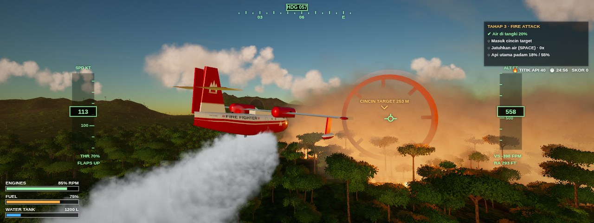

# BORNEO FIREWING · FW-218 Enggang

[](https://make.fun/competitions/best-flight-game-20261126-0057)
[](https://make.fun/competitions/best-flight-game-20261126-0057)
[](https://make.fun/competitions/best-flight-game-20261126-0057)

An original firefighting flight game made for the make.fun bounty
[Make the best flight game](https://make.fun/competitions/best-flight-game-20261126-0057).

You fly the **FW-218 "Enggang"**, a twin-turboprop amphibious water bomber, against a forest fire
(*karhutla*) in the Kalimantan rainforest. Take off from a jungle airstrip, skim a lake to fill the tank,
drop water through target rings over the fire front, save a stilt village when the wind turns, and land
back on runway 36 before the fuel runs out.



## The mission: five stages

1. **Take-off & Patrol**: start the engines, set flaps, take off and fly three patrol rings along the river.
2. **First Scoop**: touch down on the lake at 60–115 kt and skim until the tank is 80% full (the plane gets heavier).
3. **Fire Attack**: fly through the drop ring over the hottest part of the fire and hold SPACE. The fire spreads with the wind. Scoop again and repeat until the main fire is down.
4. **Save the Village**: the wind shifts and a new front races toward the rumah panggung village. Put the fire out near the village before the timer ends.
5. **Return & Land**: low fuel. Fly the green approach gate, follow the PAPI lights and land smoothly, then stop.

You fail if you crash, run out of fuel, let the village burn or run out of mission time. Each stage gets a score and stars.

## Damage and decisions

* **Engine temperature (ITT)** rises with throttle and with the hot air in the smoke. Above the 800 °C redline an
  engine wears out, can catch fire and flame out: ease the power on a drop run, or lose an engine.
* **Engine fire**: press X to fire that engine's bottle. The fire goes out and the engine stays shut down: fly home
  on one. The live engine yaws the nose toward the dead one, and the aircraft climbs and accelerates worse.
* **Bird strikes** from the hornbills over the canopy crack the windscreen, damage an engine or hole a wing (fuel leak).
* **Structure**: pulling more than 3.2 g or less than -1 g, and firm landings, cost airframe strength (more drag,
  less control authority). A damaged gear lowers the sink rate it survives.
* **Reports**: a crash ends with a crash report (impact speed, sink rate, bank and pitch, surface, g-load, damage
  and the timeline of what went wrong); a finished mission with a landing debrief (touchdown fpm, g, centreline).

## Cockpit and HUD

The cockpit view (C) has a full lit panel: six-pack flight instruments, twin-needle torque, ITT, prop and fuel-flow
gauges for both engines, fuel and water quantity, clock, G-meter, a moving-map display, 16 annunciators, radios,
master warning and caution lights and a mode panel on the glareshield. The needles jitter with engine vibration,
warnings flash, the yokes and overhead power levers follow your inputs, and soot, spray droplets and a bird-strike
crack build up on the windscreen. The HUD has speed and altitude tapes with trend arrows, stall and scoop speed bands,
a heading tape with the objective bug and wind, a radar mini-map with fires, village, rings and objective, engine and
systems panels, G-meter, master caution alerts, radio messages with a typing effect, and hit/miss feedback for drops.

## Controls

| Key | Action |
| --- | --- |
| W / S or ↑ / ↓ | pitch down / up |
| A / D or ← / → | roll |
| Q / E | rudder |
| R / F (or Shift) | throttle up / down |
| V | flaps (UP, 1, FULL) |
| SPACE (hold) | open the belly doors and drop water |
| B | wheel brakes |
| X | fire bottle: put out a burning engine (it stays shut down) |
| C | chase / cockpit camera |
| Mouse drag / wheel | look around / zoom |
| P or Esc | pause |
| M / H | sound / HUD |

On phones and tablets, touch controls appear (stick, throttle slider, drop, flaps, brake, camera, tilt steering), and a lighter graphics level is chosen automatically.

## How it is built

Plain static files in `game/` with no build step and no network requests. Three.js is vendored as
`game/vendor/three.module.min.js`. Everything else was written for this game: the aircraft is modelled in code
(`game/src/aircraft`), its livery is painted on canvases, and every sound is synthesised with Web Audio.

The rainforest covers the whole island, hills included: every tree grows from a branching skeleton
(trunk, buttress roots, scaffold limbs that fork two or three times, a leaf clump on every twig) in ten
variants (emergent dipterocarps, canopy and sub-canopy trees, light-green pioneers, palms, shrubs and ferns).
Trees near the camera are full models, further out a lighter model of the same tree, and beyond that an
impostor card baked at start-up from that tree in eight directions (colour and normals) and lit in the shader.

```
game/src/aircraft   FW-218 model and livery
game/src/flight     flight physics, damage model, annunciators
game/src/world      terrain, water, sky, forest, village, airstrip, clouds and hornbills
game/src/fire       fire spread, flames, smoke, water drop and scoop spray
game/src/mission    the five stages, rings, mission director, crash and landing report
game/src/hud        head-up display: tapes, radar, systems, messages
game/src/cockpit    cockpit shell, instrument panel, gauges, moving map, windscreen, yokes and levers
game/src/camera     chase and cockpit cameras
game/src/audio      synthesised sound
game/src/input      keyboard, mouse and touch controls
game/src/ui         title, briefing, pause and result screens, bundled fonts
game/src/shots      staged scenes for the screenshots (?shot=title|cover|cockpit|scoop|landing)
```

Run it locally with `node serve.ts` (Node 22) and open http://localhost:8080.

## License

MIT, see [LICENSE](LICENSE). The bundled fonts in `game/fonts/` (Saira Condensed, Saira Stencil One,
B612, B612 Mono, Barlow, from the google/fonts repository) are under the SIL Open Font License 1.1;
their licence texts are next to them (`OFL-*.txt`).
